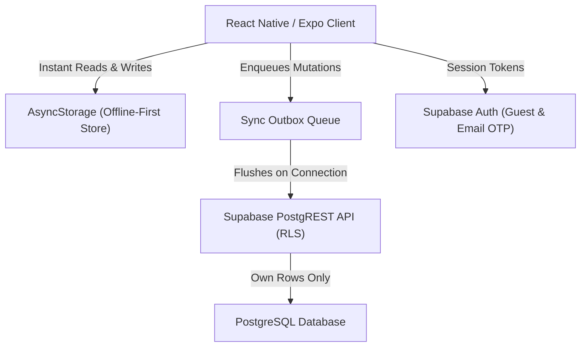

# System Architecture: Hybrid Monk

## 1. System Topology



## 2. Directory Architecture
```text
hybrid-monk/
├── .bmad/               # BMad Agile Framework (Manifest, Agents, Workflows, Sprint Status)
├── e2e/                 # Playwright E2E Onboarding Test Suite
├── supabase/            # Supabase Schema Migrations & RLS Policies
├── src/
│   ├── features/        # Business Logic & Engines
│   │   ├── alarm/       # AlarmEngine, MotionTracker, MissionRunner
│   │   ├── focus/       # BlockScheduler, PomodoroSession, AppGuard
│   │   ├── spine/       # SpineJourney (33 Vertebrae), BreathEngine (12 VBT)
│   │   └── manovigyan/  # SelfInquiry, DriftTaxonomy, SankalpStore
│   ├── navigation/      # React Navigation Root & Bottom Tabs
│   ├── screens/         # Screens for Cockpit, Routine, Sadhna, Manovigyan
│   ├── services/        # Supabase client, DbService, SyncOutbox
│   ├── theme/           # Dark Monastic Design Tokens
│   └── types/           # TypeScript Domain Models
```

## 3. Database Schema (Supabase)
Tables:
- `profiles` (`id`, `full_name`, `avatar_url`, `created_at`)
- `daily_logs` (`user_id`, `log_date`, `alarm_cleared`, `sadhna_minutes`, `manovigyan_inquiry_completed`, `daily_score`)
- `routine_plans` (`user_id`, `id`, `plan jsonb`, `updated_at`)
- `practice_attempts` (`user_id`, `id`, `practice_id`, `active_ms`, `outcome`, `started_at`)
- `self_reports` (`user_id`, `id`, `local_date`, `reached_spine`, `drift_count`, `drift_reasons`, `note`)
